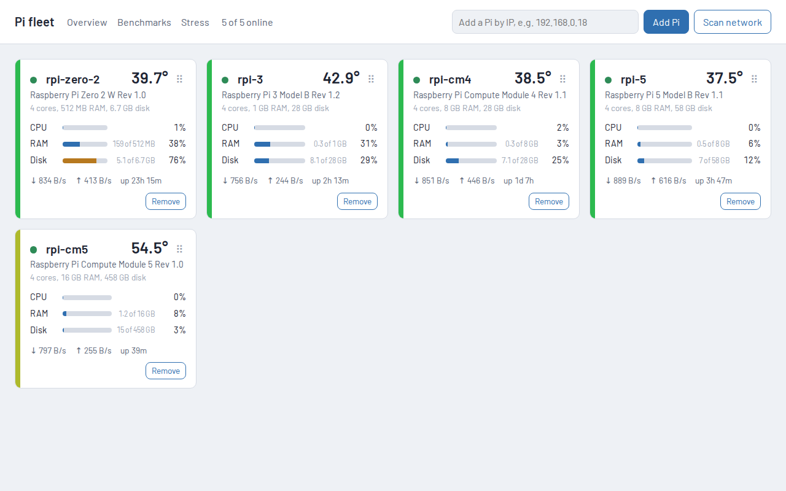
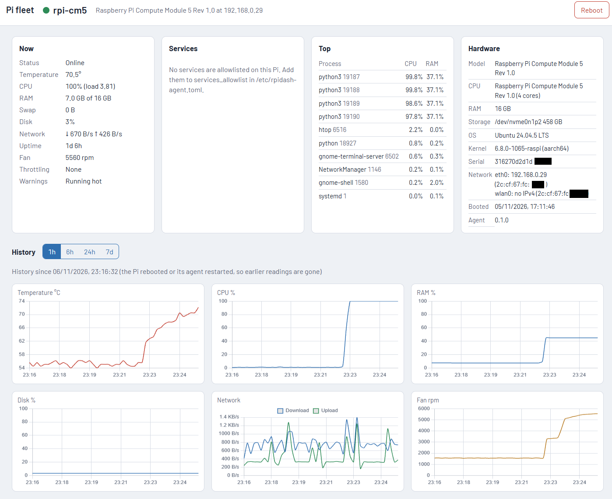
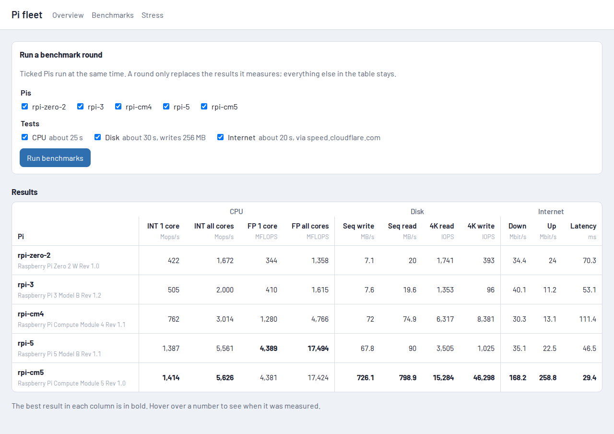
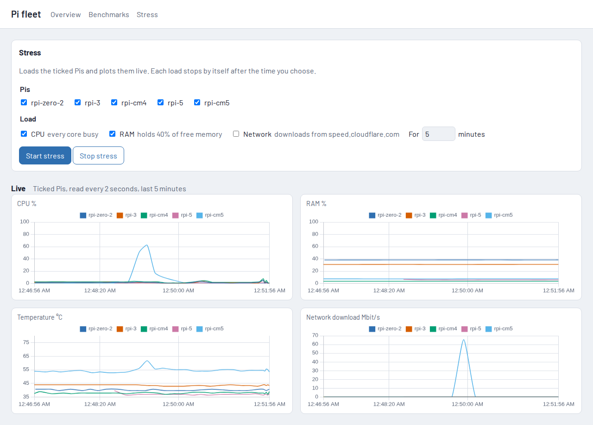

# rpi-dashboard

All your Pis, in one place. A small agent on each Raspberry Pi reports live stats, keeps
7 days of history in memory, and can reboot or shut down the Pi or restart allowlisted services. A web
dashboard shows every Pi at a glance, with charts and actions.





### Benchmarks

Tick the Pis and tests for a round; ticked Pis run in parallel. The results table is saved, so
you can come back to it later, and a round only replaces the numbers it measured.

- **CPU:** `rpibench`, a small C program built on each Pi with the same flags: integer
  (Mops/s) and floating point (MFLOPS), on one core and on all cores.
- **Disk:** sequential write/read (MB/s) and 4K random read/write (IOPS) with `O_DIRECT`,
  using a 256 MB test file that is deleted afterwards.
- **Internet:** download, upload and latency against speed.cloudflare.com.



### Stress

Start a CPU, RAM and/or network load on the ticked Pis and watch them live: CPU, RAM,
temperature and network, read every 2 seconds, one line per Pi. The network load downloads
large package-index files from Debian and Ubuntu mirrors in rotation (mirrors exist to serve
big downloads; a public speed-test site rate-limits this kind of traffic). Every load stops by itself
after the time you choose (1 to 30 minutes), or when you press Stop.



```
Browser ──▶ dashboard (desktop or a Pi) ──HTTP :8765 + token──▶ agent on each Pi
               └─ pis.json (the Pis it knows)
```

- **No database.** History lives in each agent's memory (about 3.5 MB for a full week) and
  restarts when the Pi or the agent restarts. Nothing is written to the SD card.
  Measured agent memory (RSS) on 2026-11-06: 27–29 MB on every board, Pi Zero 2 W included.
- **Pis are remembered.** The dashboard keeps `pis.json`, so you add a Pi once. If a Pi's
  DHCP address changes, the dashboard finds it again by its machine ID.
- **Safe actions.** Every call except `/health` needs the shared token. Services can only be
  started, stopped or restarted if they are in that Pi's allowlist.

## Make a token

```sh
mkdir -p ~/.config/rpidash && python3 -c "import secrets;print(secrets.token_urlsafe(32))" > ~/.config/rpidash/token
chmod 600 ~/.config/rpidash/token
```

Never commit it. The dashboard and every agent use the same token.

## Install the agent on a Pi

Needs Python 3.11 or newer, which Raspberry Pi OS (Debian 13) and Ubuntu 24.04 have.

```sh
rsync -a --delete --exclude tests --exclude build --exclude '*.egg-info' agent/ <pi>:~/rpidash-agent/
scp -p ~/.config/rpidash/token <pi>:~/rpidash-agent/token     # first install only
ssh -t <pi> "cd ~/rpidash-agent && sudo RPIDASH_SERVICES='cpu-performance,user:oled-stats' ./install.sh"
```

The token is read from that file (never the command line, so it stays out of `ps` and the
sudo log) and the file is deleted once the config is written. Running `install.sh` again
upgrades the agent and keeps the existing `/etc/rpidash-agent.toml`.
The allowlist takes system units by name, or user units of `service_user` (default: the
sudo user) written as `user:<unit>`. To change it later, edit `/etc/rpidash-agent.toml`,
then run `sudo systemctl restart rpidash-agent`.

Check it's running: `curl http://<pi-ip>:8765/health`

## Run the dashboard

On the desktop (WSL works):

```sh
uv venv .venv && uv pip install -e dashboard
cp dashboard/dashboard.example.toml dashboard.toml   # set token = the token above
.venv/bin/python -m rpidash_dashboard --config dashboard.toml --port 8080
```

Open http://127.0.0.1:8080, then use **Scan network** or add a Pi by IP. Each dashboard
instance keeps its own `pis.json`, which you can copy between machines.

On a Pi: install into `/opt/rpidash-dashboard/venv`, put the config at
`/etc/rpidash/dashboard.toml` (it can stay root-only, mode 600) with
`registry_path = "/var/lib/rpidash/pis.json"` and
`allowed_hosts` set to the names and IPs you'll browse to (for example
`["rpi-5", "192.168.0.23"]`), and use `dashboard/rpidash-dashboard.service`.

The dashboard has no login, so it only accepts requests whose Host is in `allowed_hosts`,
and it refuses reboots, shutdowns and service actions sent by other websites. Before any action it
checks that the Pi at the saved address is still the same Pi, so a DHCP address swap
can't make you reboot the wrong one.

## Develop

```sh
uv venv .venv && uv pip install -e agent -e dashboard pytest pytest-asyncio
.venv/bin/pytest
```

Design: `docs/superpowers/specs/2026-11-06-rpi-dashboard-design.md`
