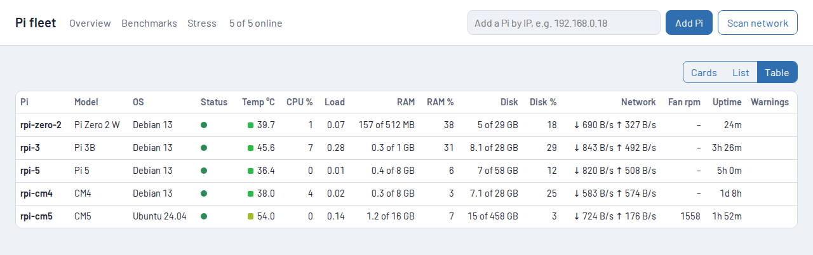

# rpi-dashboard

All your Pis, in one place. A small agent on each Raspberry Pi reports live stats, keeps
7 days of history in memory, and can reboot or shut down the Pi or restart allowlisted
services. A web dashboard shows every Pi at a glance, with charts, benchmarks, stress loads
and actions.

## What you get

### Overview: Cards, List or Table

Switch the overview between three views (top right); your choice is remembered.

- **Cards** — one card per Pi: board, OS, cores and disk type (SD, eMMC, NVMe...) on one line,
  then temperature, CPU, RAM and disk ("used of total", then %), network, uptime and warnings. The coloured edge runs from green (cool) through amber
  to red (hot).
- **List** — one compact row per Pi with the same information.
- **Table** — numbers only, one row per Pi. Click a column heading to sort (again to reverse,
  a third time to go back to your own order).

Drag a card or row (or focus its ⠿ handle and use the arrow keys) to reorder; the order is
saved. Tick Pis (or **Select all**) to **Reboot**, **Shut down** or **Run benchmarks** on all of
them at once; each Pi is still checked to be the same Pi before anything happens to it. A Pi whose agent is older than the dashboard shows **Agent out of date**.




### Detail page

Live values, the ten busiest processes, allowlisted services with Start/Stop/Restart
(the agent itself is listed first, with Restart only),
hardware details, **Reboot** and **Shut down**, and charts for temperature, CPU, RAM, disk,
network and fan speed over 1 h, 6 h, 24 h or 7 days.


### Benchmarks

Tick the Pis and tests for a round; ticked Pis run in parallel. The results table is saved, so
you can come back to it later, and a round only replaces the numbers it measured.

- **CPU:** `rpibench`, a small C program built on each Pi with the same flags: integer
  (Mops/s) and floating point (MFLOPS), on one core and on all cores.
- **Disk:** sequential write/read (MB/s) and 4K random read/write (IOPS) with `O_DIRECT`,
  using a 256 MB test file that is deleted afterwards.

Switch the table between measured values and **× slowest Pi**, where each column is divided
by its lowest-performing Pi (1.0×).


### Stress

Start a CPU, RAM, disk and/or network load on the ticked Pis and watch them live: CPU, RAM,
temperature, disk I/O and network, read every 2 seconds, one line per Pi. The RAM load fills
70% of free memory and keeps copying through it, so the memory bus is busy, not just the
space taken. The disk load writes and reads a file of up to 512 MB (sequential, then random
4K) with the page cache bypassed; it wears SD cards, so use it sparingly. The network load downloads
large package-index files from Debian and Ubuntu mirrors in rotation (mirrors exist to serve
big downloads). Every load stops by itself after the time you choose (1 to 30 minutes), or
when you press Stop.


## How it works

```
Browser ──▶ dashboard (desktop or a Pi) ──HTTP :8765 + token──▶ agent on each Pi
               └─ pis.json (the Pis it knows), bench.json (saved benchmark results)
```

- **No database.** History lives in each agent's memory (about 3.5 MB for a full week) and
  restarts when the Pi or the agent restarts. Nothing is written to the SD card in normal use.
  Measured agent memory (RSS) on 2026-11-06: 27–29 MB on every board, Pi Zero 2 W included.
- **Pis are remembered.** The dashboard keeps `pis.json`, so you add a Pi once. If a Pi's
  DHCP address changes, the dashboard finds it again by its machine ID.
- **Safe actions.** Every agent call except `/health` needs the shared token. Services can
  only be started, stopped or restarted if they are in that Pi's allowlist. The agent runs
  under a hardened systemd unit; stress loads run as separate units that stop themselves.
- **No login on the dashboard.** It only accepts requests whose Host is in `allowed_hosts`,
  and refuses reboots, shutdowns and other actions sent by other websites. Before any action
  it checks that the Pi at the saved address is still the same Pi, so a DHCP address swap
  can't make you reboot the wrong one.

## Set up

### 1. Make a token

```sh
mkdir -p ~/.config/rpidash && python3 -c "import secrets;print(secrets.token_urlsafe(32))" > ~/.config/rpidash/token
chmod 600 ~/.config/rpidash/token
```

Never commit it. The dashboard and every agent use the same token.

### 2. Install or upgrade the agent: `deploy.sh`

Needs ssh key login to each Pi (aliases in `~/.ssh/config`) and Python 3.11 or newer on the Pi
(Raspberry Pi OS / Debian 13 and Ubuntu 24.04 have it). A C compiler on the Pi is needed for
the CPU benchmark and CPU stress.

```sh
./deploy.sh                                          # every Pi in pis.json
./deploy.sh rpi-cm4 rpi-5                            # just these
./deploy.sh --services 'cpu-performance,user:oled-stats' rpi-cm4   # allowlist, first install
```

For each Pi it copies the agent, sends the token on a first install (as a file, never on a
command line), runs `install.sh` with sudo (asking for your password where the Pi needs one),
and checks the running agent reports this version. One Pi failing doesn't stop the others;
a summary table comes last.

The allowlist takes system units by name, or user units of `service_user` (default: the sudo
user) written as `user:<unit>`. To change it later, edit `/etc/rpidash-agent.toml` on the Pi,
then `sudo systemctl restart rpidash-agent`.

### 3. Run the dashboard

On the desktop (WSL works):

```sh
uv venv .venv && uv pip install -e dashboard
cp dashboard/dashboard.example.toml dashboard.toml   # set token = the token above
.venv/bin/python -m rpidash_dashboard --config dashboard.toml --port 8080
```

Open http://127.0.0.1:8080, then use **Scan network** or add a Pi by IP. Each dashboard
instance keeps its own `pis.json` and `bench.json`, which you can copy between machines.

Under WSL2 the default `--host 127.0.0.1` is widened to `0.0.0.0` automatically, because WSL's
localhost forwarding can't reach a loopback-only bind; a Windows browser can then open
`http://localhost:<port>`. WSL2's NAT keeps it off the LAN. If a Windows program already
listens on the same port (Foxit PDF takes 4000, for example), Windows wins and you see nothing,
so pick another port.

To keep it running in WSL (systemd enabled in `/etc/wsl.conf`), install
`dashboard/rpidash-dashboard-wsl.service` as a user service; it serves on port 4080
(http://localhost:4080). Install steps are in the file's header. Logs:
`journalctl --user -u rpidash-dashboard -f`. WSL itself only boots when something starts it,
and stops the distro again once no session is open, so to have the dashboard up at Windows
logon, add a logon Task Scheduler task that runs `wscript.exe start-wsl.vbs`, where
`start-wsl.vbs` holds
`CreateObject("WScript.Shell").Run "wsl.exe -d <distro> --exec /bin/sleep infinity", 0, False`
(hidden window, one session kept open).

On a Pi, see [Run the dashboard on a Pi](#run-the-dashboard-on-a-pi).

## Run the dashboard on a Pi

Install into `/opt/rpidash-dashboard/venv`, put the config at `/etc/rpidash/dashboard.toml`
(it can stay root-only, mode 600) with `registry_path = "/var/lib/rpidash/pis.json"` and
`allowed_hosts` set to the names and IPs you'll browse to (for example
`["rpi-5", "192.168.0.23"]`), and use `dashboard/rpidash-dashboard.service`.

## Add a Pico 2 W

A Raspberry Pi Pico 2 W can show on the dashboard too. `pico/` holds a small MicroPython
agent that speaks the same protocol on port 8765 with the same token. It reports chip
temperature, RAM (the MicroPython heap), flash used, Wi-Fi signal and uptime, and keeps
history for 7 days (in RAM, so a reset clears it). The dashboard gives it its own card and
a shorter detail page. Things a microcontroller can't do (shut down, services, benchmarks,
stress) are hidden in the dashboard and refused by the Pico with a clear message.

The Pico is plugged by USB into one of the Pis (`rpi-5` by default; set `PICO_HOST` to use
another), and the code is uploaded through that Pi:

1. On that Pi, install mpremote: `python3 -m venv ~/pico/.venv && ~/pico/.venv/bin/pip install mpremote`.
2. Flash MicroPython 1.29 or later (the `RPI_PICO2_W` UF2): hold BOOTSEL while plugging it
   in, or, if it already runs MicroPython, `~/pico/.venv/bin/mpremote bootloader`; then copy
   the UF2 to the `RP2350` drive.
3. On the desktop, copy `pico/wifi_config.example.py` to `pico/wifi_config.py` (it's
   gitignored) and fill in your Wi-Fi name, password, country code and hostname.
4. Run `./pico/dev.sh`. It uploads the code and your dashboard token (as `token.txt`),
   resets the Pico and shows its output (Ctrl-] to leave). `./pico/dev.sh repl` opens the
   REPL only. Connecting with mpremote stops the program on the Pico; reset it to start again.
5. Add it on the dashboard by its hostname or IP, like a Pi.

The agent runs on core 0; your own code goes in `pico/app.py` and runs on core 1 (the file
explains `setup()`, `step()`, `PERIOD_MS` and what core 1 mustn't touch). The Pico's page
shows its state, the values it publishes and any crash, with a Restart button; CPU use is
shown per core. A crash or a `step()` that never returns shows as a warning on the card.

The Pico's version (`VERSION` in `pico/main.py`) is separate from the Pis' and is checked
against `EXPECTED_PICO_VERSION` in `dashboard/rpidash_dashboard/__init__.py`.

## Change the token

```sh
./deploy.sh --rotate-token          # every Pi in pis.json (or name the Pis)
```

It makes a new token, sends it to each Pi as a file and swaps it into that Pi's config
(allowlists and other settings are kept). Only when **every** Pi in the run has it does it
switch the desktop over: the new token becomes `~/.config/rpidash/token` (the old one is kept
as `token.old`) and `dashboard.toml` is updated; then restart the dashboard. If some Pis
fail, the new token waits in `token.new`, and `./deploy.sh --rotate-token <those Pis>` reuses
it. Until the dashboard restarts, Pis that already have the new token show **Token rejected**.
A Pico isn't reached by `deploy.sh`: run `./pico/dev.sh` again after rotating.

## Versions

The agent and dashboard are released together and share a version number
(`agent/rpidash_agent/__init__.py`, `dashboard/rpidash_dashboard/__init__.py`; a test keeps
them in step). Bump it with every agent change, then run `./deploy.sh`; any Pi still on an
older agent shows **Agent out of date** until it is upgraded.

## Develop

```sh
uv venv .venv && uv pip install -e agent -e dashboard pytest pytest-asyncio
.venv/bin/pytest
```

Designs: `docs/superpowers/specs/2026-11-06-rpi-dashboard-design.md` (dashboard and agent),
`docs/superpowers/specs/2026-11-07-bench-stress-design.md` (benchmarks and stress).
